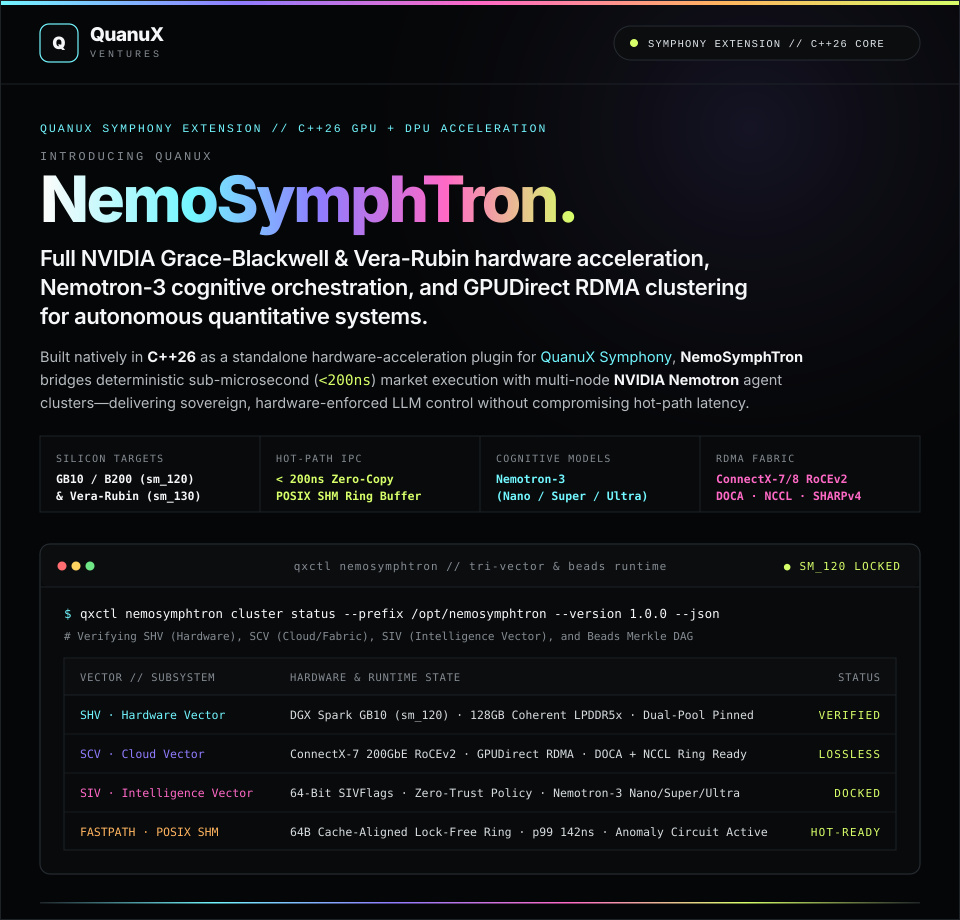
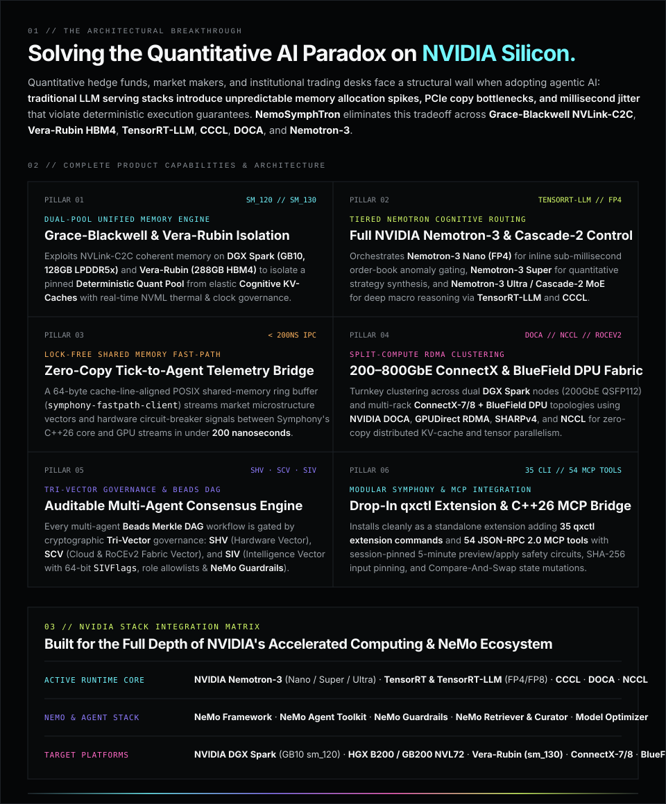
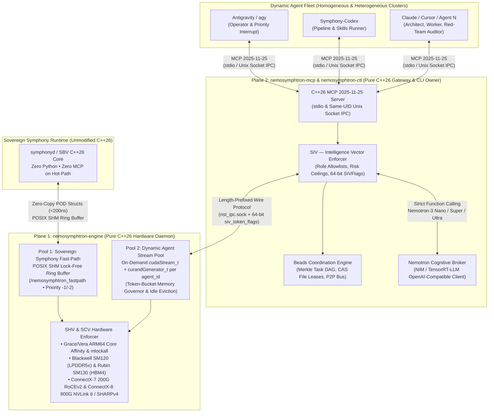

<div align="center">
  
  
</div>

<br />

## `04 // FORMAL SYSTEM ARCHITECTURE & DUAL-POOL EXECUTION`

**QuanuX NemoSymphTron** (`https://github.com/QuanuX/NemoSymphTron`) is a standalone **C++26** NVIDIA hardware acceleration, **NVIDIA Nemotron** cognitive orchestration, Tri-Vector (`SHV` / `SCV` / `SIV`) governance, and **Beads** multi-agent clustering extension for [**QuanuX Symphony**](https://github.com/QuanuX/Symphony) (`https://quanux.org`, `https://docs.quanux.org`).

It is engineered for **NVIDIA DGX Spark** (Grace-Blackwell `GB10` `sm_120`, 128 GB unified LPDDR5x, ConnectX-7 200GbE RoCEv2) and next-generation **NVIDIA Vera-Rubin** (Vera ARM64 + Rubin `sm_130`, 288 GB HBM4, ConnectX-8 800G / NVLink 6 Switch with SHARPv4 and BlueField-4 DPU offload), while providing a deterministic C++26 IEEE-754 hardware-emulation fallback on macOS and non-GPU development hosts.



---

### Dual-Plane C++26 Separation

NemoSymphTron strictly separates real-time quantitative execution from cold-path agentic orchestration across two pure C++26 planes (`-std=c++2c -Wall -Wextra -Wpedantic -Werror`):

#### 1. Plane 1 — Sovereign C++26 CUDA & Beads Engine (`nemosymphtron-engine`)
* **Pool 1 (Sovereign Symphony Fast-Path)**:
  * Zero-copy POSIX shared memory (`SovereignSharedChannel` at `/nemosymphtron_fastpath`) with 64-byte cache-line-aligned (`alignas(64)`) lock-free SPSC ring buffers (`LockFreeRingBuffer<T, 256>`).
  * Dedicated highest-priority CUDA stream (`priority = -1` on Blackwell `sm_120`, `priority = -2` on Vera-Rubin `sm_130`).
  * Sub-200ns IPC latency (`symphony-fastpath-client`), completely isolated from LLM/MCP traffic.
* **Pool 2 (Dynamic Multi-Agent Stream Pool)**:
  * Accepts length-prefixed binary frames (`proto/nemosymphtron_wire.proto`) over a local `0600` UID-verified Unix domain socket (`AF_UNIX`).
  * Validates 64-bit **SIV (Intelligence Vector)** capability bitmasks (`SIVFlags`) in `O(1)` `constexpr` constant time (`SIV_AUDITED_BEAD`, `SIV_RISK_CHECK_PASSED`, `SIV_DETERMINISTIC_MATH_DELEGATED`, `SIV_PRIORITY_BOOST`).
  * Provisions per-agent non-blocking CUDA streams (`cudaStreamNonBlocking`) and executes **6 hardware-accelerated quantitative & distributed kernels**:

| Kernel ID | Operation | Hardware Acceleration & Numerical Guarantee |
| :--- | :--- | :--- |
| `MONTE_CARLO_VAR` | Multi-asset Geometric Brownian Motion VaR / CVaR | `cuRAND` + FP64/FP32 path simulation with exact 99% VaR / CVaR tail reduction |
| `CHOLESKY_DECOMP` | Positive-definite covariance matrix factorization | `cuSOLVER` (`cusolverDnDpotrf`) $LL^T$ decomposition with condition-number checks |
| `CUOPT_PORTFOLIO` | Mean-variance / Sharpe ratio portfolio optimization | `cuBLAS` / projected-gradient simplex solver with weight-sum invariants |
| `TX_RISK_SCORE` | Real-time transaction & microstructure anomaly scoring | Sub-millisecond inline anomaly scoring (`ALLOW` / `CHALLENGE` / `BLOCK`) |
| `FFT_OPTION_PRICING` | Carr-Madan Fast Fourier Transform option pricing | `cuFFT` spectral European/exotic option surface evaluation |
| `NCCL_MULTI_NODE_SIM` | Multi-node RoCEv2 / NVLink 6 SHARPv4 All-Reduce | `NCCL` ring/tree & in-network SHARPv4 collective reduction across cluster nodes |

#### 2. Plane 2 — C++26 MCP (`2025-11-25`) Gateway & `qxctl` Extension Owner (`nemosymphtron-mcp` & `nemosymphtron-ctl`)
* Exposes **35 registered `qxctl` extension commands** (`qxcmd:nemosymphtron:*` in `catalog/qxctl_extension_commands.json`) and **54 MCP tools** (`nemosymphtron_connection` + 53 operation-specific read/preview/apply tools in `catalog/tools.json`).
* Enforces single-use 5-minute session-bound previews (`owner_plan_executed: false`, `authorization_granted: false`), direct input file SHA-256 pinning (`direct_file_sha256`), and Compare-And-Swap (`--expected-state-digest`) state mutations.
* Never blind-retries unknown mutation outcomes (`transport_outcome: "unknown_requires_owner_reconciliation"`, `retry_automatically: false`).

---

## `05 // TRI-VECTOR (SHV · SCV · SIV) GOVERNANCE & BEADS CLUSTERING`

| Vector / Engine | Scope | Responsibilities |
| :--- | :--- | :--- |
| **`SHV` · Hardware Vector** | Node & Silicon (`sm_120` / `sm_130`) | ARM64 Grace/Vera CPU core affinity (`pthread_setaffinity_np`), `mlockall(MCL_CURRENT \| MCL_FUTURE)` page locking, Unified Memory oversubscription protection, and NVML thermal/clock guardrails. |
| **`SCV` · Cloud Vector** | RoCEv2 & NVLink 6 Fabric | ConnectX-7 (200GbE QSFP112) and ConnectX-8 (800GbE) lossless RoCEv2 (`MTU 9000`, PFC/ECN), NVIDIA DOCA, GPUDirect RDMA (`nvidia-peermem`), and SHARPv4 collective readiness. |
| **`SIV` · Intelligence Vector** | Zero-Trust Cognitive Policy | Enforces 64-bit `SIVFlags` bitmasks, agent role allowlists, risk ceilings, NeMo Guardrails, and tiered routing across **Nemotron-3 Nano / Super / Ultra** and **Nemotron-Cascade-2 MoE**. |
| **`Beads` · Multi-Agent DAG** | Distributed Agent Consensus | SHA-256 Merkle Task DAG (`PENDING` → `CLAIMED` → `COMMITTED` / `FAILED`), Compare-And-Swap (`CAS`) file leases to prevent concurrent agent write collisions, and P2P adversarial cross-check bus. |

---

## `06 // BUILDING, VERIFICATION & SYMPHONY INTEGRATION`

### Build & Run All 6 CTest Verification Suites

```bash
cmake -S . -B build -DCMAKE_BUILD_TYPE=Release
cmake --build build -j 4
ctest --test-dir build --output-on-failure
cmake --install build --prefix .
```

The test suite verifies all 6 C++26 and Python integration harnesses:
1. `fastpath-shm` — 64-byte cache-aligned POSIX shared-memory lock-free ring buffer & all 5 fast-path kernels.
2. `siv-beads-unit` — `constexpr` 64-bit `SIVFlags` policy enforcement, Beads Merkle-DAG transitions, CAS file leases, P2P bus, and `SHV`/`SCV` hardware profiles (`sm_120` & `sm_130`).
3. `engine-ipc` — Length-prefixed binary wire protocol framing and `DualPoolQuantEngine` execution over `AF_UNIX`.
4. `mcp-gateway` — JSON-RPC 2.0 MCP `2025-11-25` protocol handshake, 54-tool catalog discovery, and 5-minute session-bound preview/apply enforcement.
5. `multi-agent-cluster` — Multi-agent heterogeneous fleet coordination (`antigravity-operator`, `claude-architect`, `symphony-codex`, `cursor-worker`) with live `nemosymphtron-engine` and `symphony-fastpath-client`.
6. `qxctl-extension` — Non-destructive registration, verification, and deregistration of all 35 `qxcmd:nemosymphtron:*` commands.

### Integrating with a QuanuX Symphony Installation

NemoSymphTron never modifies the upstream `QuanuX/Symphony` repository. Its `qxctl` extensions are registered only when attached to an explicit Symphony installation prefix:

```bash
python3 scripts/integrate_qxctl_extension.py register \
  --symphony-prefix /opt/symphony \
  --nemosymphtron-ctl ./bin/nemosymphtron-ctl \
  --extension-catalog ./catalog/qxctl_extension_commands.json \
  --version 1.0.0 \
  --tops-id 11111111-2222-3333-4444-555555555555
```

---

## `07 // REPOSITORY LAYOUT & LICENSE`

```text
NemoSymphTron/
├── assets/                          # quanux.org dark-mode SVG architecture & hero panels
├── catalog/
│   ├── qxctl_extension_commands.json # 35 qxcmd:nemosymphtron:* extension command definitions
│   └── tools.json                    # 53 operation-specific MCP tools + nemosymphtron_connection
├── config/                          # systemd cgroups v2 slice & Netplan 200GbE RoCEv2 configs
├── include/nemosymphtron/           # Pure C++26 headers (SHV, SCV, SIV, Beads, FastPath, IPC)
├── proto/nemosymphtron_wire.proto   # Binary IPC wire protocol specification
├── rules/AGENTS.md                  # Architectural & operational doctrine for AI agents
├── schemas/                         # JSON Schema Draft 2020-12 contracts (SHV, SCV, SIV, Beads)
├── scripts/                         # qxctl integration, DGX Spark / Rubin audit, & catalog tools
├── skills/                          # 4 specialized agent skills (tri-vector, beads, spark, rubin)
├── src/                             # C++26 sources (engine, ctl, mcp, fastpath-client, transport)
├── templates/                       # Hardware, RoCEv2 fabric, SIV policy, & Beads cluster templates
└── tests/                           # C++26 unit tests & Python multi-agent / MCP integration tests
```

Licensed under **`AGPL-3.0-only`** — see [LICENSE](LICENSE).

<hr />

<div align="center">
  <sub><strong>QUANUX VENTURES LLC</strong> // <a href="https://quanux.org">QUANUX.ORG</a> · <a href="https://docs.quanux.org">DOCS.QUANUX.ORG</a> · <a href="https://github.com/QuanuX/Symphony">QUANUX SYMPHONY</a> // AGENTIC-FIRST · HUMANS WELCOME</sub>
</div>
