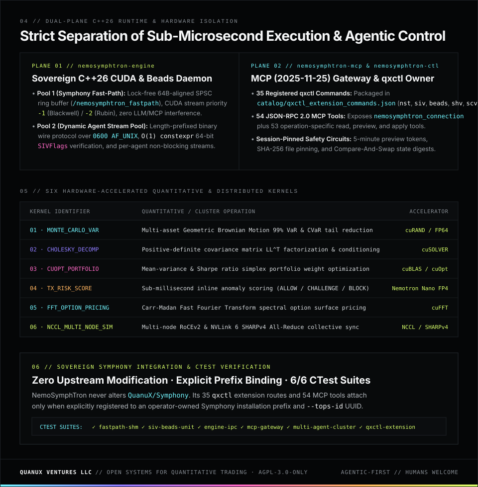
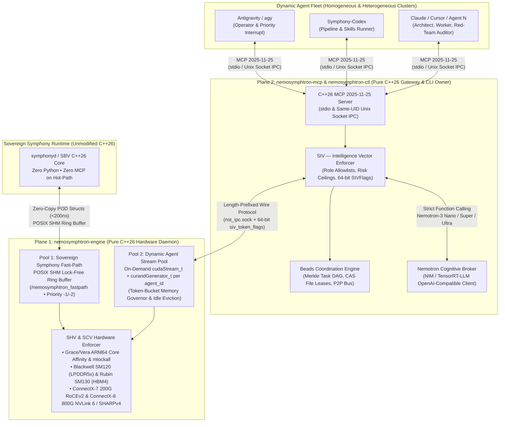

<div align="center">
  
  
  
</div>

<br />

## `SYSTEM TOPOLOGY // MERMAID SPECIFICATION`



---

## `QUICKSTART // BUILD, VERIFY & ATTACH TO SYMPHONY`

### 1. Build & Run All 6 CTest Verification Suites

```bash
cmake -S . -B build -DCMAKE_BUILD_TYPE=Release
cmake --build build -j 4
ctest --test-dir build --output-on-failure
cmake --install build --prefix .
```

### 2. Attach `qxctl` Extensions to an Explicit Symphony Installation

NemoSymphTron does not modify the upstream [`QuanuX/Symphony`](https://github.com/QuanuX/Symphony) repository. Its 35 `qxctl` extension commands (`qxcmd:nemosymphtron:*`) are registered only when attached to an explicit Symphony installation prefix:

```bash
python3 scripts/integrate_qxctl_extension.py register \
  --symphony-prefix /opt/symphony \
  --nemosymphtron-ctl ./bin/nemosymphtron-ctl \
  --extension-catalog ./catalog/qxctl_extension_commands.json \
  --version 1.0.0 \
  --tops-id 11111111-2222-3333-4444-555555555555
```

### 3. Repository Structure

```text
NemoSymphTron/
├── assets/                          # quanux.org dark-mode SVG architecture, hero, & spec panels
├── catalog/
│   ├── qxctl_extension_commands.json # 35 qxcmd:nemosymphtron:* extension command definitions
│   └── tools.json                    # 53 operation-specific MCP tools + nemosymphtron_connection
├── config/                          # systemd cgroups v2 slice & Netplan 200GbE RoCEv2 configs
├── include/nemosymphtron/           # Pure C++26 headers (SHV, SCV, SIV, Beads, FastPath, IPC)
├── proto/nemosymphtron_wire.proto   # Binary IPC wire protocol specification
├── rules/AGENTS.md                  # Architectural & operational doctrine for AI agents
├── schemas/                         # JSON Schema Draft 2020-12 contracts (SHV, SCV, SIV, Beads)
├── scripts/                         # qxctl integration, DGX Spark / Rubin audit, & catalog tools
├── skills/                          # 4 specialized agent skills (tri-vector, beads, spark, rubin)
├── src/                             # C++26 sources (engine, ctl, mcp, fastpath-client, transport)
├── templates/                       # Hardware, RoCEv2 fabric, SIV policy, & Beads cluster templates
└── tests/                           # C++26 unit tests & Python multi-agent / MCP integration tests
```

### 4. License

Licensed under **`AGPL-3.0-only`** — see [LICENSE](LICENSE).

<div align="center">
  <sub><strong>QUANUX VENTURES LLC</strong> // <a href="https://quanux.org">QUANUX.ORG</a> · <a href="https://docs.quanux.org">DOCS.QUANUX.ORG</a> · <a href="https://github.com/QuanuX/Symphony">QUANUX SYMPHONY</a> // AGENTIC-FIRST · HUMANS WELCOME</sub>
</div>
