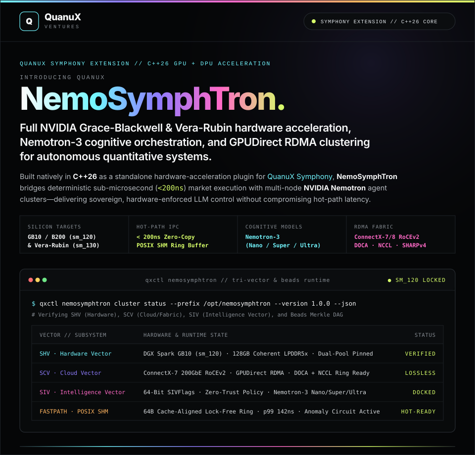
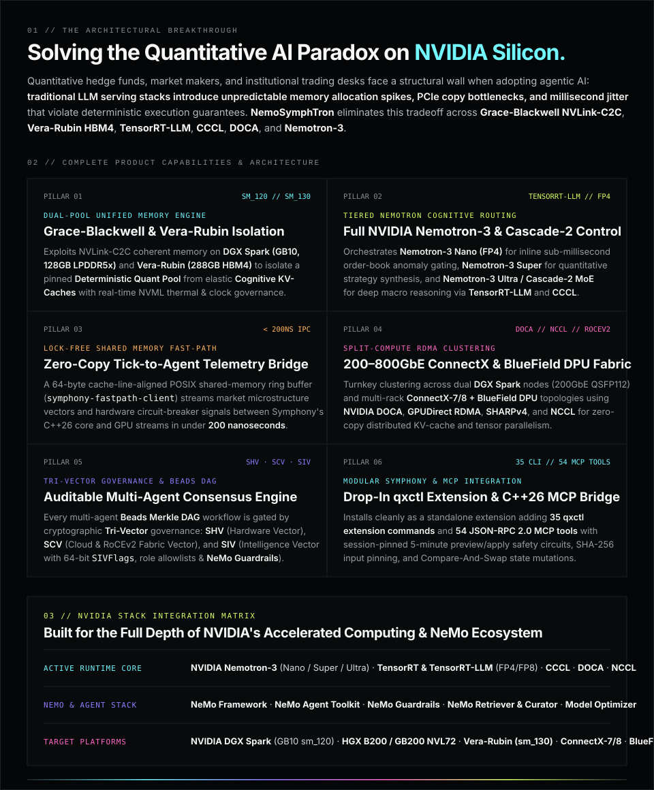
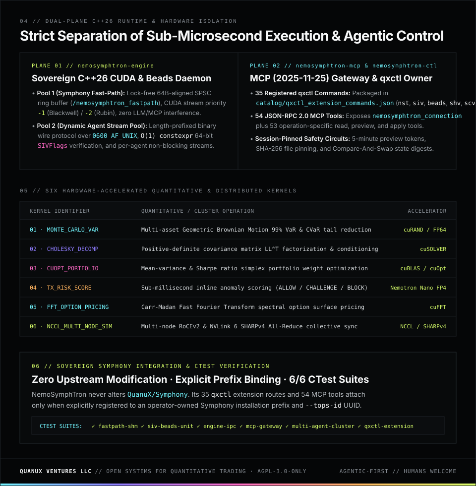
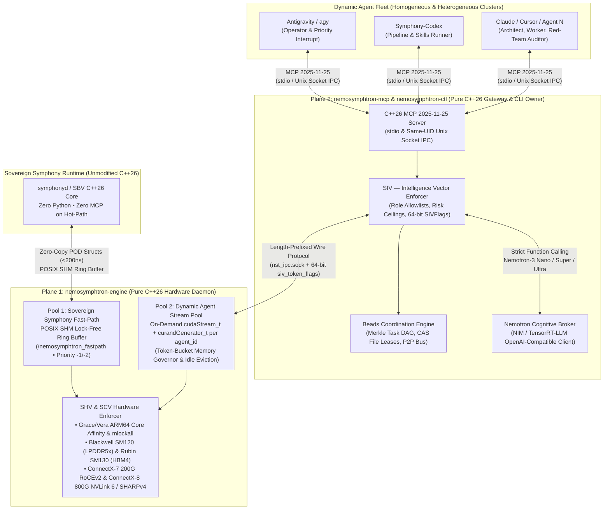

<div align="center">
  
  
  
</div>

<br />

## Try NemoSymphTron with Symphony beta.2.1

The `0.2.0-beta.2.1` release installs a native CPU experiment runtime, four skills and a private, read-only connection. The Codex and Antigravity plugins use a separate MCP server named `nemosymphtron`. You can keep the Symphony plugin enabled in the same client to inspect both command registries. Each server has its own pinned native owner.

**Requirements** include Python 3.9+, macOS 15 or later (Intel or Apple Silicon), or Ubuntu 24.04/26.04 (x86-64 or ARM64). For Codex, install a client with `codex plugin marketplace` support. For Antigravity, use a client with local plugin support. The release installer gets its native archive and SHA-256 digest from the tagged GitHub release. It asks for no administrator privileges, model credentials or GPU drivers.

Download the installer once, then run the command for your client.

```sh
curl -fL -o install-nemosymphtron.py https://github.com/QuanuX/NemoSymphTron/releases/download/v0.2.0-beta.2.1/install-nemosymphtron.py
```

**Codex**

```sh
python3 install-nemosymphtron.py --client codex
```

**Antigravity**

```sh
python3 install-nemosymphtron.py --client antigravity
```

Antigravity installs this user’s plugin under `~/.gemini/config/plugins/nemosymphtron`. To limit it to an open project, append `--workspace "$PWD"`. `agy plugin list --json` lists user plugins. For a workspace install, run `agy plugin validate --strict --json .agents/plugins/nemosymphtron`.

Start a new Codex session or reopen the Antigravity workspace. Try this prompt in either client.

> Call `nemosymphtron_connection` and `nemosymphtron_commands_list`. Report the bridge version and number of routable commands. If Symphony is installed, also call `symphony_connection` and report the separate Symphony registry. Use read-only tools.

The Nemo connection should report `0.2.0-beta.2.1`, 35 routable native commands, and an empty list of enabled non-read commands. These results come from the local executable. The CPU package starts no resident engine or model server. The built-in cognitive planner parses a directive locally and returns a recommended tool and model label. Model weights, external NIM/TensorRT inference, CUDA execution and DGX/Rubin fabric qualification are separate from this experiment. To explore the native CUDA configuration, build from source on a compatible NVIDIA system.

The default prefix is `~/.local/share/quanux/nemosymphtron`. Use `--prefix` to select another location. Run the installer again with the other `--client` to enable both. To attach a Nemo command capsule to a specific Symphony prefix, follow the explicit registration example below. [Release assets](https://github.com/QuanuX/NemoSymphTron/releases/tag/v0.2.0-beta.2.1) · [Support](https://support.quanux.org)

## `SYSTEM TOPOLOGY // MERMAID SPECIFICATION`



---

## `QUICKSTART // BUILD, VERIFY & ATTACH TO SYMPHONY`

### 1. Build & Run All 6 CTest Verification Suites

```bash
cmake -S . -B build -DCMAKE_BUILD_TYPE=Release
cmake --build build -j 4
ctest --test-dir build --output-on-failure
cmake --install build --prefix .
```

### 2. Attach `qxctl` Extensions to an Explicit Symphony Installation

NemoSymphTron does not modify the upstream [`QuanuX/Symphony`](https://github.com/QuanuX/Symphony) repository. Its 35 `qxctl` extension commands (`qxcmd:nemosymphtron:*`) are registered only when attached to an explicit Symphony installation prefix:

```bash
python3 scripts/integrate_qxctl_extension.py register \
  --symphony-prefix /opt/symphony \
  --nemosymphtron-ctl ./bin/nemosymphtron-ctl \
  --extension-catalog ./catalog/qxctl_extension_commands.json \
  --version 0.2.0-beta.2.1 \
  --tops-id 11111111-2222-3333-4444-555555555555
```

### 3. Repository Structure

```text
NemoSymphTron/
├── assets/                          # quanux.org dark-mode SVG architecture, hero, & spec panels
├── catalog/
│   ├── qxctl_extension_commands.json # 35 qxcmd:nemosymphtron:* extension command definitions
│   └── tools.json                    # 53 operation-specific MCP tools + nemosymphtron_connection
├── config/                          # systemd cgroups v2 slice & Netplan 200GbE RoCEv2 configs
├── include/nemosymphtron/           # Pure C++26 headers (SHV, SCV, SIV, Beads, FastPath, IPC)
├── proto/nemosymphtron_wire.proto   # Binary IPC wire protocol specification
├── rules/AGENTS.md                  # Architectural & operational doctrine for AI agents
├── schemas/                         # JSON Schema Draft 2020-12 contracts (SHV, SCV, SIV, Beads)
├── scripts/                         # qxctl integration, DGX Spark / Rubin audit, & catalog tools
├── skills/                          # 4 specialized agent skills (tri-vector, beads, spark, rubin)
├── src/                             # C++26 sources (engine, ctl, mcp, fastpath-client, transport)
├── templates/                       # Hardware, RoCEv2 fabric, SIV policy, & Beads cluster templates
└── tests/                           # C++26 unit tests & Python multi-agent / MCP integration tests
```

### 4. License

Licensed under **`AGPL-3.0-only`** — see [LICENSE](LICENSE).

<div align="center">
  <sub><strong>QUANUX VENTURES LLC</strong> // <a href="https://quanux.org">QUANUX.ORG</a> · <a href="https://docs.quanux.org">DOCS.QUANUX.ORG</a> · <a href="https://github.com/QuanuX/Symphony">QUANUX SYMPHONY</a> // AGENTIC-FIRST · HUMANS WELCOME</sub>
</div>
